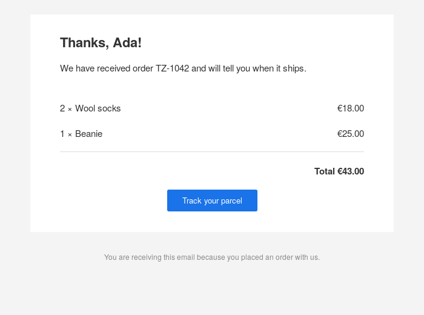
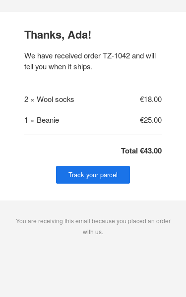

# MJML for Haskell

Write responsive emails in Haskell and send HTML that works in every mail
client, with no Node.js anywhere.

## What MJML is

HTML email is stuck in the past. Outlook renders with Word's engine, Gmail
strips most CSS, and phones need layouts that stack. Email that looks right
everywhere is built from nested tables, inline styles and Outlook-only
conditional comments, and nobody wants to write that by hand.

[MJML](https://mjml.io) is a markup language that writes it for you. You
describe the email with a few components: sections, columns, text, images,
buttons, dividers, social links. MJML turns them into the HTML that every
client renders the same way, with columns that stack on narrow screens.

It is a good fit for any email your application sends:

* transactional mail: order confirmations, receipts, shipping updates,
  password resets, invoices;
* notifications and digests;
* newsletters and announcements.

This repository brings MJML to Haskell:

| Package | |
|---|---|
| [`mjml`](mjml) | Renders MJML documents to HTML. A port of the reference implementation that produces the same HTML as MJML 5. |
| [`mjml-hamlet`](mjml-hamlet) | Writes MJML templates in Hamlet's syntax. MJML's validation happens at compile time, and interpolated values are escaped. |

## Example: an order confirmation

A template with `mjml-hamlet`. Data goes in with `#{...}`, `$forall` repeats
a row per item, and `$maybe` adds the tracking button only when there is a
link:

```haskell
{-# LANGUAGE OverloadedRecordDot #-}
{-# LANGUAGE QuasiQuotes #-}

import Data.Text (Text)
import Text.Mjml (MjmlError, Node)
import Text.Mjml.Hamlet (SafeUrl, mjml, renderMjml)

data Order = Order
    { reference :: Text
    , customer :: Text
    , items :: [Item]
    , total :: Text
    , trackingUrl :: Maybe SafeUrl
    }

data Item = Item {name :: Text, quantity :: Int, price :: Text}

confirmation :: Order -> Either MjmlError Text
confirmation order =
    renderMjml
        [mjml|
        <mjml>
          <mj-head>
            <mj-title>Order #{order.reference}
            <mj-preview>Thanks for your order, #{order.customer}
            <mj-attributes>
              <mj-all font-family="Helvetica, Arial, sans-serif">
              <mj-text font-size="15px" line-height="22px" color="#333333">
          <mj-body background-color="#f4f4f4">
            <mj-section padding="12px">
            <mj-section background-color="#ffffff" padding="24px">
              <mj-column>
                <mj-text font-size="22px" font-weight="bold">Thanks, #{order.customer}!
                <mj-text>We have received order #{order.reference} and will tell you when it ships.
            $forall item <- order.items
              <mj-section background-color="#ffffff" padding="0 24px">
                <mj-group>
                  <mj-column width="70%">
                    <mj-text>#{item.quantity} × #{item.name}
                  <mj-column width="30%">
                    <mj-text align="right">#{item.price}
            <mj-section background-color="#ffffff" padding="0 24px 24px">
              <mj-column>
                <mj-divider border-color="#dddddd" border-width="1px">
                <mj-text align="right" font-weight="bold">Total #{order.total}
                $maybe url <- order.trackingUrl
                  <mj-button href=#{url} background-color="#1a73e8">Track your parcel
            ^{footer}
        |]

-- A piece shared by every email, embedded above with ^{footer}.
footer :: [Node]
footer =
    [mjml|
    <mj-section>
      <mj-column>
        <mj-text font-size="12px" color="#888888" align="center">
          You are receiving this email because you placed an order with us.
    |]
```

The result, on a desktop client and on a phone:

<p>
  
  
</p>

This template becomes about 13 KB of HTML with 29 tables and 25 Outlook
conditional comments. `mj-group` keeps each item and its price side by side on
the phone; plain columns would stack.

Mistakes are compile errors that point at the template:

```
Confirmation.hs:24:39: Attribute align has invalid value: middle for type Enum, only accepts left, right, center, justify
Confirmation.hs:30:17: mj-text cannot be used inside mj-section, only inside: mj-column, mj-hero
```

## Example: rendering an MJML file

The `mjml` package renders MJML's own XML syntax, so templates made with the
[MJML editor](https://mjml.io/try-it-live) or kept from a Node.js setup work
as they are:

```haskell
import Data.Text.IO qualified as T
import Text.Mjml (defaultOptions, renderText)

main :: IO ()
main = do
    source <- T.readFile "welcome.mjml"
    either print (T.writeFile "welcome.html") (renderText defaultOptions source)
```

```xml
<mjml>
  <mj-body>
    <mj-section>
      <mj-column>
        <mj-image src="https://example.com/logo.png" width="120px" />
        <mj-text font-size="20px">Welcome aboard</mj-text>
        <mj-button href="https://example.com/start">Get started</mj-button>
      </mj-column>
    </mj-section>
  </mj-body>
</mjml>
```

## How faithful is it?

The `mjml` test suite renders 155 documents covering every MJML component and
its attributes, and compares each result with the HTML that MJML 5.4.1 itself
produced. They all match. The comparison ignores whitespace, attribute order
and the order of CSS declarations, and nothing else. See
[`mjml/README.md`](mjml/README.md) for what is not supported yet.

## Development

```sh
cabal build all
cabal test all
```

To regenerate the expected HTML with the reference implementation, for
instance after upgrading MJML in `scripts/package.json`:

```sh
npm ci --prefix scripts
node scripts/update-fixtures.mjs
```

The templates in this README are compiled and rendered by the `mjml-hamlet`
test suite (`mjml-hamlet/test/Readme.hs`), so they stay correct.

## License

MIT
