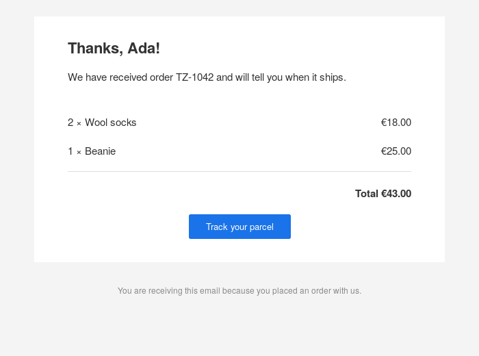
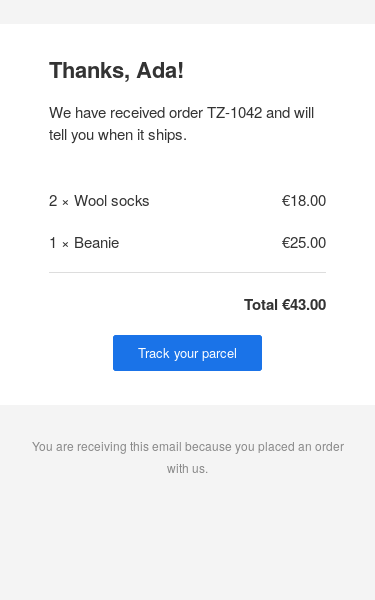

# mjml

Render [MJML](https://mjml.io) responsive email templates to HTML from Haskell,
without Node.js.

MJML describes an email with a few components (sections, columns, text,
images, buttons) and compiles them to the nested tables, inline styles and
Outlook conditional comments that render the same in every mail client, with
columns that stack on phones. This package is a port of the reference
JavaScript implementation and produces the same HTML as MJML 5. To write
templates in Haskell with compile-time checks, see
[`mjml-hamlet`](https://github.com/kronor-io/mjml/tree/main/mjml-hamlet).

An order confirmation rendered by this package, on a desktop client and on a
phone (the template is in the `mjml-hamlet` README):





```haskell
import Data.Text.IO qualified as T
import Text.Mjml (defaultOptions, renderText)

main :: IO ()
main =
    either print T.putStrLn $
        renderText defaultOptions
            "<mjml>\
            \  <mj-body>\
            \    <mj-section>\
            \      <mj-column>\
            \        <mj-text font-size=\"20px\">Your order is on its way</mj-text>\
            \        <mj-button href=\"https://example.com/track\">Track it</mj-button>\
            \      </mj-column>\
            \    </mj-section>\
            \  </mj-body>\
            \</mjml>"
```

## Escaping

Like MJML, the renderer copies attribute values and the content of ending tags
(`mj-text`, `mj-button`, `mj-raw`, …) into the output as they are: they are
HTML source, not text. Escape anything that comes from user data before putting
it into a document.

## Compatibility

The output is compared with MJML 5.4.1 for the 155 documents in
`test/fixtures`. The comparison ignores whitespace, attribute order and the
order of CSS declarations, and nothing else.

Not supported yet:

* `mj-include`, which MJML also ignores unless asked to read files;
* inlining `<mj-style inline="inline">` (the style is kept in the head);
* `mj-html-attributes`;
* minification and beautification.

## Updating the fixtures

The expected HTML is regenerated with the reference implementation:

```sh
npm ci --prefix scripts
node scripts/update-fixtures.mjs
```

## License

MIT. The fixture inputs come from [mrml](https://github.com/jdrouet/mrml),
also MIT; see `test/fixtures/NOTICE.md`.
